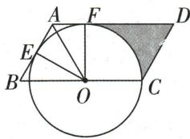

<!-- question-source:start -->
3[2024 江苏泰州校级期末, 中] 如图, □ABCD 中, O 为 BC 上一点, AO 平分 ∠BAD, 以 O 为圆心, OC 为半径的圆与 AB 相切于点 E, 连接 OE, 作 OF⊥AD 于点 F.

(1) 求证: $\odot O$ 与 AD 相切.

(2) 若 $DF = 7, BO = 5$ , 且 $\angle D > 45^{\circ}$ , 求阴影部分的面积.

<!-- question-source:end -->

![[Q00106988A1]]
