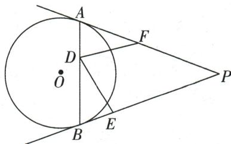

<!-- question-source:start -->
4[较难]如图, $PA$ 和 $PB$ 是 $\odot O$ 的两条切线, $A, B$ 为切点, 点 $D$ 在 $AB$ 上, 点 $E$ 和点 $F$ 分别在 $PB$ 和 $PA$ 上, 且 $AD = BE$ .

(1) 求证: $PA = PB$ .

(2) 若 $\angle P = 40^{\circ}$ , 当 $\angle EDF$ 是多少度时, $BD = AF$ ? 请说明理由.

(3) 若 $\angle APB = \alpha$ , 当 $\alpha =$ \_\_\_\_时, 四边形 DEPF 为菱形.

是个新“烤”鸭

电子错题本鸭
<!-- question-source:end -->

![[Q00107272A1]]
