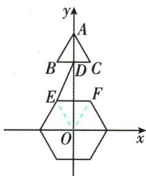

> [!success]- 必刷题
>
> > [!success] **【答案】** B
>
> > [!note]- **【解析】**
> > 如图, 连接 OE. 根据 $DE \geqslant OD - \blacktriangleright$ 思路分析
> >
> > OE, 可知当点 E 在线段 OD 上时, DE 的值最小. $\because \triangle ABC$ 是边长为 2 的等边三角形, 点 A 的坐标为 $(0,6)$ , BC 的中点 D 在 y 轴上, $\therefore AD \perp BC$ , OA = 6,
> >
> > 
> >
> > 首先得到当点E在线段OD上时，DE的值最小，然后分别求得AD，OD,OE的长，最后即可求得DE的最小值.
> >
> > $BD=CD=\frac{1}{2}BC=1,\therefore AD=\sqrt{AB^{2}-BD^{2}}=\sqrt{3},$ ∴ $OD = OA - AD = 6 - \sqrt{3}$ . 连接 OF. ∵ 正六边形的边长为 2, 中心在原点 O 处, ∴ EF = 2, $\angle EOF = 60^{\circ}, OE = OF, \therefore \triangle EOF$ 是等边三角形, ∴ OE = EF = 2, ∴ DE 的最小值为 $OD - OE = 4 - \sqrt{3}$ ,
> >
> > 故选 **B**.
