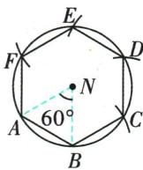
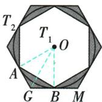

> [!success]- 必刷题
>
> > [!success] **【答案】** 详见解析
>
> > [!note]- **【解析】**
> > 【解】(1)如图(1),正六边形ABCDEF即为所求.作法:①在圆N中作圆心角 $\angle ANB=60^{\circ}$ ;
> > - **②**：从点B开始,在圆N上逆时针依次截取与 $\widehat{AB}$ 相等的弧得到C,D,E,F;
> > - **③**：顺次连接A,
> >
> > 
> > 图(1)
> >
> > B,C,D,E,F,六边形 ABCDEF 即为所求正六边形.
> >
> > (2) 如图 (2), 连接 $OA, OB, OG$ . 由正六边形 $T_{2}$ 的各边与圆 $O$ 相切可得 $\angle GBO = 90^{\circ}$ . 由正六边形的性质可得 $\angle OGB = \angle AOB = 60^{\circ}, \therefore \triangle AOB$ 是等边三角形, $\angle BOG = 30^{\circ}$ ,
> >
> > 
> > 图(2)
> >
> > ## 思路分析
> >
> > $\therefore AB = OA = R$ ，即正六边形 $T_{1}$ 的边长为 $R$ $BG = \frac{1}{2} OG.$ 设 $BG = x$ ，由勾股定理得 $x^{2} + R^{2} = (2x)^{2}$ ，解得 $x = \frac{\sqrt{3}}{3} R$ ，则 $MG = \frac{2\sqrt{3}}{3} R$ ，故正六边形 $T_{2}$ 的边长为 $\frac{2\sqrt{3}}{3} R.$ (3)易得内接正六边形 $T_{1}$ 的面积为 $6S_{\triangle AOB} = \frac{3\sqrt{3}}{2} R^{2}$ ，外切正六边形 $T_{2}$ 的面积为 $12S_{\triangle OGB} = 2\sqrt{3} R^{2},\therefore S_{\text{阴影}} = 2\sqrt{3} R^{2} - \frac{3\sqrt{3}}{2} R^{2} =$ $(2\sqrt{3} -\frac{3\sqrt{3}}{2})R^2 = \frac{\sqrt{3}}{2} R^2.$
> >
> > (2) 设 $\odot O$ 的半径为 r，根据平行四边形、角平分线的性质得 AB = OB = 5, $AF + 7 = 5 + r$ ，再由切线长定理得 AF = AE = r - 2，即可得出 BE = 7 - r，利用勾股定理结合 $\angle B > 45^{\circ}$ 求出 r 的值，再利用割补法即可求解.
