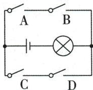

<!-- question-source:start -->
2 新考向跨学科综合 如图,电路图上有4个开关A,

B,C,D和1个小灯泡,在所有的元件和线路都正常的前提下,下列操作中,“小灯泡发光”这个事件是随机事件的是 ( )
A.只闭合1个开关 B.只闭合2个开关 C.只闭合3个开关 D.闭合4个开关

<!-- question-source:end -->

![[Q00107022A1]]
