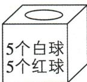
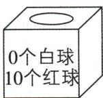
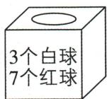
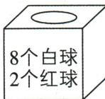

<!-- question-source:start -->
5 新考法[2025 广东揭阳质检]如图, 四个不透明的盒子里分别装了一些球, 这些球除颜色外完全相同. 四名同学在其中的同一个盒子里玩摸球游戏, 每人摸 20 次, 下表是他们摸出红球、白球的次数情况. 根据表中的数据推测他们在哪个盒子中玩摸球游戏的可能性最大（）

<table><tr><td></td><td>小红</td><td>小明</td><td>小华</td><td>小丽</td></tr><tr><td>红球(次)</td><td>3</td><td>10</td><td>7</td><td>5</td></tr><tr><td>白球(次)</td><td>17</td><td>10</td><td>13</td><td>15</td></tr></table>

A

B

C

D
<!-- question-source:end -->

![[Q00107025A1]]
