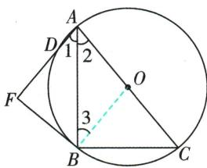
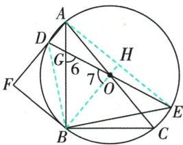

> [!success]- 必刷题
>
> > [!success] **【答案】** B
>
> > [!note]- **【解析】**
> > A 选项, 只闭合 1 个开关, 小灯泡不会发光, 属于不可能事件, 不符合题意; B 选项, 只闭合 2 个开关, 小灯泡可能发光也可能不发光, 是随机事件, 符合题意; C 选项, 只闭合 3 个开关, 小灯泡一定会发光, 是必然事件, 不符合题意; D 选项, 闭合 4 个开关, 小灯泡一定会发光, 是必然事件, 不符合题意. 故选 B.
> >
> > (2) 连接 AE, BD, BO, 延长 BO 交 AE 于 H, 证明四边形 AFBH 为矩形, 得到 AH = BF, AF = BH, 得出 OH 为 $\triangle ADE$ 的中位线, 再运用勾股定理进行计算, 即可求得结果.
> >
> > ## 关键点拨
> >
> > 解题的关键是根据题意判断闭合开关后小灯泡能否发光. 开关 A, B 同时闭合小灯泡可以发光, 开关 C, D 同时闭合小灯泡可以发光.
> >
> > 设 $DF = x, \therefore BH = AF = x + 1$ . $\because OH \perp AE, \therefore AH = EH.$ $\because DO = EO, \therefore OH$ 为 $\triangle ADE$ 的中位线， $\therefore OH = \frac{1}{2} AD = \frac{1}{2}, \therefore OB = BH - OH = x + \frac{1}{2}$ . $\because AF // OB, \therefore \angle ADG = \angle 7.$ $\because AD = AG = 1, \therefore \angle ADG = \angle AGD.$ 又 $\because \angle AGD = \angle 6, \therefore \angle 6 = \angle 7, \therefore BG = OB = OA = x + \frac{1}{2}, \therefore AB = BG + AG = x + \frac{3}{2}$ .
> > 在 Rt $\triangle AOH$ 中，根据勾股定理得 $AH^2 = AO^2 - OH^2 = x^2 + x, \therefore BF^2 = AH^2 = x^2 + x.$ 在 Rt $\triangle AFB$ 中，根据勾股定理得 $AF^2 + BF^2 = AB^2$ ，即 $(x + 1)^2 + (x^2 + x) = \left(x + \frac{3}{2}\right)^2$ ，解得 $x = \frac{\sqrt{5}}{2}$ （负值已舍去）， $\therefore DF = \frac{\sqrt{5}}{2}$ .
> >
> > 
> > 图(1)
> >
> > 
> > 图(2)
