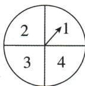

<!-- question-source:start -->
3 如图是一个被等分成四份的游戏转盘, 自由转

动转盘一次(如果落在分隔线上, 则重新转动,直至转到其中一块区域),则指针落在数字“4”所示区域内的概率是
A. $\frac{1}{3}$ B. $\frac{1}{4}$ C. $\frac{1}{6}$ D. $\frac{1}{9}$

<!-- question-source:end -->

![[Q00107030A1]]
