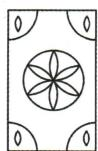
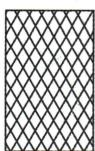
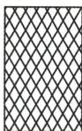

<!-- question-source:start -->
4 如图,桌面上有三张卡片,一张正面朝上.任意将其中一张卡片正反面对调一次,则这三张卡片中出现两张正面朝上的概率是 ( )

正面

反面

反面

A. 1 B. $\frac{2}{3}$ C. $\frac{1}{3}$ D. $\frac{1}{9}$
<!-- question-source:end -->

![[Q00107031A1]]
