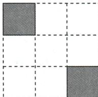

<!-- question-source:start -->
1[2025 浙江杭州西湖区校级期中, 中]如图, 在

3×3 的正方形网格中, 已有两个小正方形被涂黑, 在图中剩余的小正方形中任意选择一个涂黑, 则三个被涂黑的小正方形能构成轴对称图形的概率是
A. $\frac{1}{7}$ B. $\frac{3}{7}$ C. $\frac{4}{7}$

( )

$$
\begin{array}{c} \frac {5}{7} \end{array}
$$
<!-- question-source:end -->

![[Q00107037A1]]
