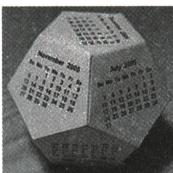
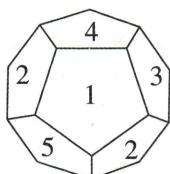

<!-- question-source:start -->
2[中]正十二面体是五个柏拉图立体之一,共有二十个顶点、三十条棱和十二个面,且每一个面皆是正五边形. 图(1)是一个正十二面体的日历,图(2)是小贤根据图(1)设计的一枚质地均匀的正十二面体的骰子,其中1个面标有“1”,2个面标有“2”,3个面标有“4”,其余的面标有“3”或“5”,掷一次这枚骰子,标有“4”的面朝上的概率是()

图(1)

图(2)

A. $\frac{1}{6}$ B. $\frac{1}{4}$ C. $\frac{1}{3}$ D. $\frac{1}{2}$
<!-- question-source:end -->

![[Q00107038A1]]
