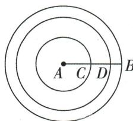

<!-- question-source:start -->
3[2025 江苏盐城期末, 中]如图, 点 C, D 在线段 AB 上, 且 AC:CD:DB=3:2:1. 以点 A 为圆心, 分别以线段 AC, AD, AB 为半径画同心圆, 记以 AC 为半径的圆为区域 I, CD 所在的圆环为区域 II, DB 所在的圆环为区域 III. 现在此图形中随机撒一把豆子, 统计落在 I、II、III 三个区域内的豆子数. 若大量重复此试验, 则 ( )

A. 豆子落在区域Ⅰ的概率最小
B. 豆子落在区域Ⅱ的概率最小
C. 豆子落在区域Ⅲ的概率最小
D. 豆子落在区域Ⅰ、Ⅱ、Ⅲ的概率相等

<!-- question-source:end -->

![[Q00107039A1]]
