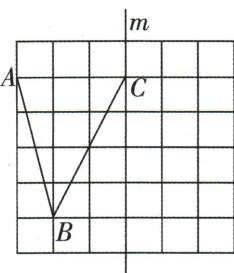

<!-- question-source:start -->
7 思想方法 数形结合 [中] 如图, $\triangle ABC$ 的顶点在正方形网格的格点上.

(1)画 $\triangle DEF$ ，使它与 $\triangle ABC$ 关于直线 $m$ 对称（点 $A,B,C$ 的对应点分别为点 $D,E,F)$

(2) 如果在网格内任意找一点, 这个点在 $\triangle ABC$ 和 $\triangle DEF$ 外的概率是多少?

课时1 用列表法求概率
<!-- question-source:end -->

![[Q00107043A1]]
