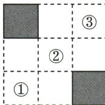

> [!success]- 必刷题
>
> > [!success] **【答案】** B
>
> > [!note]- **【解析】**
> > 如图, 图中共剩余 7 个小正方形,
> >
> > 归纳总结
> > 一般地, 如果在一次试验中, 有 n 种可能的结果, 并且它们发生的可能性都相等, 事件 A 包含其中的 m 种结果, 那么事件 A 发生的概率 $P(A) = \frac{m}{n}$ .
> >
> > ## 思路分析
> >
> > (1) 利用网格的特点和轴对称的性质找到点 A, B, C 关于直线 m 的对称点 D, E, F, 再顺次连接即可;
> >
> > (2) 先求出 $\triangle ABC$ 和 $\triangle DEF$ 外的面积, 以及网格的面积, 再根据概率公式求解即可.
> >
> > 当①②③任意一个小正方形被涂黑时,三个被涂黑的小正方形能构成轴对称图形,
> > ∴ 三个被涂黑的小正方形能
> >
> > 
> >
> > 构成轴对称图形的概率是 $\frac{3}{7}$ ，
> >
> > 故选 **B**.
