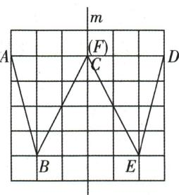

> [!success]- 必刷题
>
> > [!success] **【答案】** 详见解析
>
> > [!note]- **【解析】**
> > 【解】(1)如图所示, $\triangle DEF$ 即为所求作.
> >
> > (2)设每个小正方形的边长为1,则网格的面积为 $6\times6=36$ , $\triangle ABC$ 和 $\triangle DEF$ 外的面积为 $36-3\times4\div2\times2=24$ ,故这个点在 $\triangle ABC$ 和 $\triangle DEF$ 外的概率是 $\frac{24}{36}=\frac{2}{3}$ .
> >
> > 
> >
> > ## 25.2 用列举法求概率
> >
> > ## 课时1 用列表法求概率
