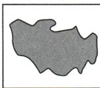
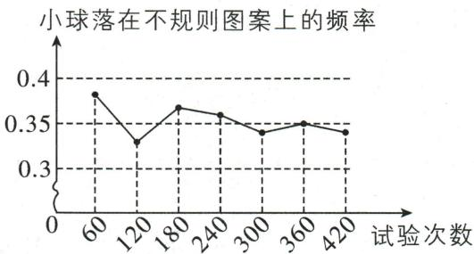

<!-- question-source:start -->
3[2024 湖北宜昌质检]如图(1), 平整的地面上有一个不规则图案(图(1)的阴影部分), 小明想了解该图案的面积是多少, 他采

图(1)

取了如下方法:用一个面积为 $20 \, cm^{2}$ 的长方形,将不规则图案围起来,然后在适当位置随机地朝长方形区域扔小球(小球大小忽略不计), 并记录小球落在不规则图案上的次数(球扔在界线上或长方形区域外不计试验结果), 他将若干次有效试验的结果绘制成了如图(2)所示的折线统计图, 由此他估计不规则图案的面积大约为 \_\_\_\_ cm².

图(2)
<!-- question-source:end -->

![[Q00107070A1]]
