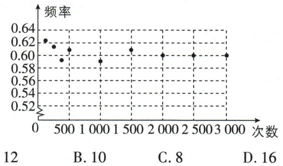

<!-- question-source:start -->
1[2023 河北石家庄期中, 中]在一个不透明的口袋中, 放置 6 个红球、2 个白球和 n 个黄球. 这些小球除颜色外其余均相同, 数学小组每次摸出一个球记录下颜色后再放回, 并且统计了黄球出现的频率, 如图, 则 n 的值可能是 ( )

A. 12 B. 10 C. 8 D. 16
<!-- question-source:end -->

![[Q00107072A1]]
