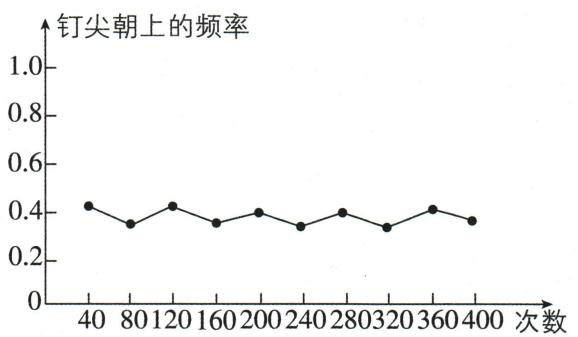
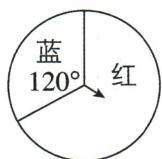
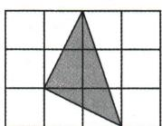

<!-- question-source:start -->
2[中]下面四个试验中,试验结果概率最小的是()

图(1)

图(2)

图(3)

A. 如图(1), 在一次试验中, 老师共做了 400 次掷图钉游戏, 并记录了游戏的结果且绘制成折线统计图, 估计出的钉尖朝上的概率

B. 如图(2)是一个可以自由转动的转盘, 任意转动转盘, 当转盘停止时, 指针落在蓝色区域的概率

C. 如图(3), 有一个小球在地板上自由滚动, 地板上的每个格都是边长为 1 的正方形, 则小球在地板上最终停留在灰色区域的概率

D. 有除所标数字外完全相同的 7 张卡片, 分别标有数字 1, 2, 3, 4, 6, 8, 9, 将它们背面朝上洗匀后, 从中随机抽出一张, 抽出所标数字 “大于 6” 的卡片的概率
<!-- question-source:end -->

![[Q00107073A1]]
