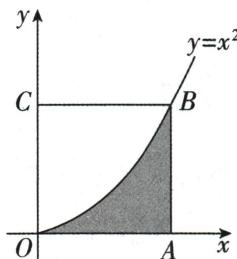

<!-- question-source:start -->
3[2024 四川成都期中, 中]如图, 在正方形 OABC 中, OA = 1, 二次函数 $y = x^{2} (x > 0)$ 的图象过点 O 和点 B, 为了测算该二次函数的图象

与边 OA, AB 围成的阴影部分面积, 某同学在正方形 OABC 内随机投掷 900 个点, 已知恰有 300 个点落在阴影部分内 (点投掷在边界上或正方形区域外则重投), 据此估计阴影部分的面积为 \_\_\_\_.
<!-- question-source:end -->

![[Q00107074A1]]
