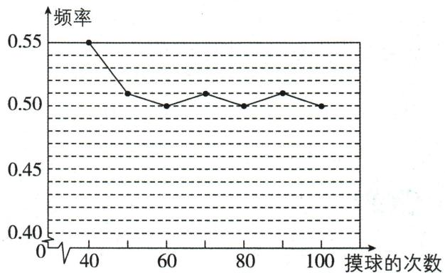

<!-- question-source:start -->
4 核心素养 数据观念 [2025 山东济南期末, 中] 在一个不透明的盒子里装有只有颜色不同的黑、白两种球共 20 个, 小颖做摸球试验, 她将盒子里面的球搅匀后从中随机摸出一个球记下颜色, 再把它放回盒子中, 不断重复上述过程, 下图是“摸到白球”的频率折线统计图.

(1)请估计:当摸球次数很多时,摸到白球的频率将会接近\_\_\_\_;(精确到0.1)

(2)试估计盒子里黑、白两种颜色的球各有多少个；

(3)在(2)的条件下,如果要使摸到白球的概率为 $\frac{3}{5}$ ,需要往盒子里再放入多少个白球?

是个新“烤”鸭

电子错题本鸭
<!-- question-source:end -->

![[Q00107075A1]]
