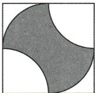

<!-- question-source:start -->
2[2023 山东烟台中考]如图,在正方形中,阴影部分是以正方形的顶点及其对称中心为圆心,以正方形边长的一半为半径作弧形成的封闭图形.将一个小球在该正方形内自由滚动,小球随机地停在正方形内的某一点上.若小球停在阴影部分的概率为 $P_{1}$ ,停在空白部分的概率为 $P_{2}$ ,则 $P_{1}$ 与 $P_{2}$ 的大小关系为 ( )

A. $P_{1} <   P_{2}$ $\mathrm{B.P_1 = P_2}$ C. $P_{1} > P_{2}$ D.无法判断
<!-- question-source:end -->

![[Q00107077A1]]
