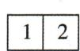

<!-- question-source:start -->
7[2023 辽宁鞍山中考]在一个不透明的口袋中装有红球和白球共12个,这些球除颜色外都相同,将口袋中的球搅匀后,从中随机摸出1个球,记下它的颜色后再放回口袋中,不断重复这一过程,共摸球200次,发现有50次摸到红球,则口袋中红球约有\_\_\_\_个.

<!-- question-source:end -->

![[Q00107089A1]]
