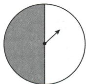
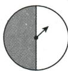

<!-- question-source:start -->
2[2025 河北邯郸调研]如图,转盘甲与转盘乙中黑、白部分的面积均相等.用力转动转盘甲和转盘乙,两个转盘的指针停在白色区域的概率分别为 $P_{甲},P_{乙}$ ,则下列关系正确的是()

A. $P_{\text{甲}} > P_{\text{乙}}$ B. $P_{\text{甲}} < P_{\text{乙}}$ C. $P_{\text{甲}} = P_{\text{乙}}$ D. 无法确定 $P_{\text{甲}}, P_{\text{乙}}$ 的大小

转盘甲

转盘乙
<!-- question-source:end -->

![[Q00107091A1]]
