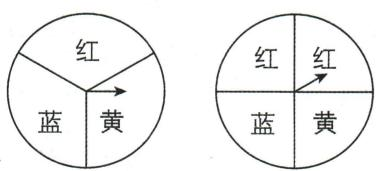

<!-- question-source:start -->
4[2024宁夏银川校级期中]小英和小丽用如图所示的两个转盘做“配紫色”游戏(红色和蓝色在一起配成紫色),每个转盘均被分成面积相等的几个扇形,将两个转盘各转动一次,若配成紫色,则小英获胜,否则小丽获胜,则小英获胜的概率是\_\_\_\_,小丽获胜的概率是\_\_\_\_,可知这个游戏规则\_\_\_\_(填“公平”或“不公平”).

<!-- question-source:end -->

![[Q00107275A1]]
