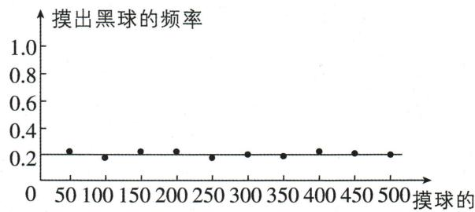

<!-- question-source:start -->
5 社团课上,同学们进行了“摸球游戏”:在一个不透明的盒子里装有几十个除颜色不同外其余均相同的黑、白两种球,将盒子里面的球搅匀后从中随机摸出一个球记下颜色,再把它放回盒子中,不断重复上述过程.整理数据后,制作了“摸出黑球的频率”与“摸球的总次数”的关系图象如图所示,经分析可以推断盒子里个数比较多的是\_\_\_\_.(填“黑球”或“白球”)

<!-- question-source:end -->

![[Q00107276A1]]
