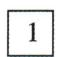
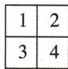

<!-- question-source:start -->
6 生活在数字时代的我们,很多场合用二维码来表示不同的信息,类似地,可通过在矩形网格中,对每一个小方格涂色或不涂色所得的图形来表示不同的信息,例如:网格中只有一个小方格,如图(1),通过涂色或不涂色可表示两个不同的信息.

(1)用画树状图或列表的方法,求图(2)可表示不同信息的总个数;(图中标号1,2表示两个不同位置的小方格,下同)

(2)图(3)为 $2\times2$ 的网格图,它可表示不同信息的总个数为\_\_\_\_;

(3)某校需要给每位师生制作一张“校园出入证”，准备在证件的右下角采用 $n \times n$ 的网格图来表示个人身份信息，若该校师生共492人，则n的最小值为\_\_\_\_。

图(1)

图(2)
图(3)
<!-- question-source:end -->

![[Q00107277A1]]
