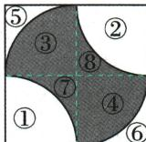

> [!success]- 必刷题
>
> > [!success] **【答案】** B
>
> > [!note]- **【解析】**
> > 如图，∵ ①②③④四个扇形的半径相等，圆心角相等，∴ $S_{①} = S_{②} = S_{③} = S_{④}$ ，∴ $S_{⑤} = S_{⑥} = S_{⑦} = S_{⑧}$ . ∵ $P_{1} =$
> >
> > 
> >
> > $$
> > \frac {S _ {③} + S _ {④} + S _ {⑦} + S _ {⑧}}{S _ {\text {大正方形}}}, P _ {2} = \frac {S _ {①} + S _ {②} + S _ {⑤} + S _ {⑥}}{S _ {\text {大正方形}}}, \therefore P _ {1} = P _ {2}.
> > $$
