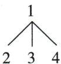
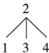
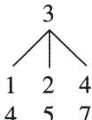
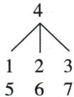

> [!success]- 必刷题
>
> > [!success] **【答案】** 详见解析
>
> > [!note]- **【解析】**
> > 【解】(1)画树状图如下：
> >
> > 甲
> >
> > 
> >
> > 
> >
> > 
> >
> > 
> >
> > 由树状图可知,一共有12种等可能的结果,其中两球上的数字之和为奇数的结果有8种,∴甲获胜的概率为 $\frac{8}{12}=\frac{2}{3}$ .
> >
> > (2) 这个游戏规则对甲乙双方不公平, 理由如下: 由(1)中的树状图可知, 两球上的数字之和为偶数的结果有4种, ∴乙获胜的概率为 $\frac{4}{12} = \frac{1}{3}$ . ∵ $\frac{1}{3} < \frac{2}{3}$ , ∴这个游戏规则对甲乙双方不公平.
