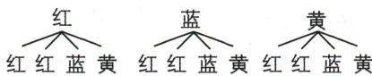

> [!success]- 必刷题
>
> > [!success] **【答案】** $\frac{1}{4},\frac{3}{4}$ ，不公平
>
> > [!note]- **【解析】**
> > 画树状图如下：
> >
> > 
> >
> > 共有 12 种等可能的结果, 其中配成紫色的结果数为 3, 所以小英获胜的概率为 $\frac{3}{12} = \frac{1}{4}$ , 则小丽获胜的概率为 $\frac{3}{4}$ . 因为 $\frac{1}{4}<\frac{3}{4}$ ，所以这个游戏规则不公平. 故答案为 $\frac{1}{4},\frac{3}{4}$ ，不公平.
