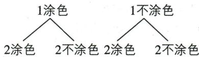
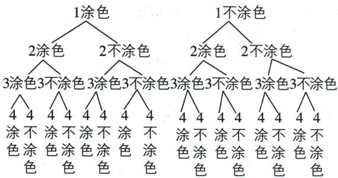

> [!success]- 必刷题
>
> > [!success] **【答案】** 16
>
> > [!note]- **【解析】**
> > 【解】(1)画树状图如下：
> >
> > 
> >
> > 共有 4 种等可能的结果, ∴ 题图(2)可表示不同信息的总个数为 4.
> >
> > (2)画树状图如下:
> >
> > 
> >
> > 共有 16 种等可能的结果,∴ 题图(3)可表示不同信息的总个数为 16. 故答案为 16.
> >
> > (3)由题图(1)得当 n=1 时, 可表示不同信息的总个数为 $2^{1}=2$ , 由题图(3)得当 n=2 时, 可表示不同信息的总个数为 $2^{2} \times 2^{2} = 16$ , ∴ 当 n=3 时, 可表示不同信息的总个数为 $2^{3} \times 2^{3} \times 2^{3} = 512$ . ∵ 16 < 492 < 512, ∴ n 的最小值为 3. 故答案为 3.
> >
> > ## 中考新考向备训
