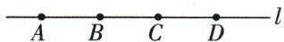

<!-- question-source:start -->
1[2025 山西太原期中]如图, 点 A, B, C, D 均在直线 l 上, 点 P 在直线 l 外, 从这五个点中随机选择三个点, 则经过这三个点能够画出圆的概率为 ( )

A. $\frac{1}{3}$ B. $\frac{1}{2}$ C. $\frac{2}{5}$ D. $\frac{3}{5}$
<!-- question-source:end -->

![[Q00107044A1]]
