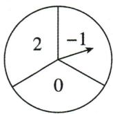
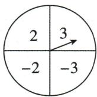

<!-- question-source:start -->
3 如图, 两个相同的可以自由转动的转盘 A 和 B, 转盘 A 被三等分, 分别标有数字 2, 0, -1; 转盘 B 被四等分, 分别标有数字 3, 2, -2, -3. 如果同时转动转盘 A, B, 转盘停止时, 两个指针指向转盘 A, B 上的对应数字分别为 x, y (当指针指在两个扇形的交线时, 需重新转动转盘), 那么点 $(x, y)$ 落在平面直角坐标系中的第二象限的概率是 ( )

A

B

A. $\frac{1}{6}$ B. $\frac{1}{3}$ C. $\frac{1}{2}$ D. $\frac{2}{3}$

建议用时 25 分钟 答案 D79
<!-- question-source:end -->

![[Q00107046A1]]
