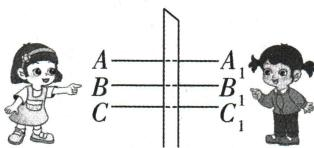

<!-- question-source:start -->
5[2024 江苏镇江期中]如图,三根同样的绳子 $AA_{1},BB_{1},CC_{1}$ 穿过一块木板,姐妹两人分别站在木板的左、右两侧,每次各自选取本侧的一根绳子,每根绳子被选中的机会相等.
(1)姐姐从这三根绳子中随机选一根,恰好选中绳子 $BB_{1}$ 的概率为\_\_\_\_;
(2)在互相看不见的条件下,姐姐从左端A,B,C三个绳头中随机选两个打一个结,妹妹从右端 $A_{1},B_{1},C_{1}$ 三个绳头中随机选两个打一个结,求这三根绳子能连接成一根长绳的概率.

<!-- question-source:end -->

![[Q00107048A1]]
