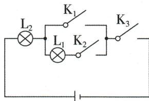

<!-- question-source:start -->
1 新考向跨学科综合 如图,随机闭合开关 $K_{1},K_{2},K_{3}$ 中的两个,则能让两盏灯泡 $L_{1},L_{2}$ 同时发光的概率为 ( )

A. $\frac{1}{6}$ B. $\frac{1}{2}$ C. $\frac{2}{3}$ D. $\frac{1}{3}$
<!-- question-source:end -->

![[Q00107049A1]]
