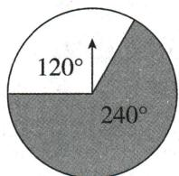

<!-- question-source:start -->
2[2025 浙江湖州质检]如图,转盘上白色扇形和黑色扇形的圆心角分别为 $120^{\circ}$ 和 $240^{\circ}$ , 让转盘自由转动两次, 则指针一次落在白色区域, 一次落在黑色区域的概率是 ( )

A. $\frac{1}{9}$ B. $\frac{2}{9}$ C. $\frac{1}{3}$ D. $\frac{4}{9}$
<!-- question-source:end -->

![[Q00107050A1]]
