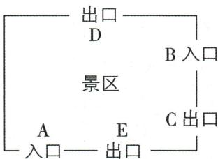

<!-- question-source:start -->
3 如图, 十一旅游黄金周期间, 西溪景区规定 A 和 B 为入口, C, D, E 为出口. 小红随机选一个入口进入景区, 游玩后任选一个出口离开, 则她选择从 A 口进入, 从 D 口离开的概率是 ( )

A. $\frac{1}{3}$ B. $\frac{1}{2}$ C. $\frac{1}{6}$ D. $\frac{2}{5}$
<!-- question-source:end -->

![[Q00107051A1]]
