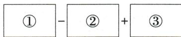

<!-- question-source:start -->
7[2024 河北承德质检]三张完全相同的纸片上分别写有一个代数式,分别是 $A=4x^{2}+5x+6$ , $B=-3x^{2}-x-2$ , $C=x^{2}+4x$ .

(1) $A-B+C$ 的值为P. 当x=2时,求P的值.

(2) 将三张纸片背面向上, 打乱顺序后, 在背面分别标上①②③, 摆成如图所示的一个式子, 请用画树状图法或列表法求出能使运算结果为常数的概率.

<!-- question-source:end -->

![[Q00107055A1]]
