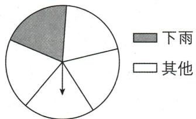

<!-- question-source:start -->
2[2025 浙江衢州期中, 中]据天气预报, 某天 A 地的降雨概率为 20%, B 地的降雨概率为 50%, 小明根据 A 地降雨的概率设计了一个转盘模型来模拟试验(如图). 请解答下列问题:

(1)请你再设计一个转盘模型来模拟试验 B 地下雨的概率.

(2)请利用设计的模型求出某天 A 地、B 地都下雨的概率.

公主王子请刷题鸭
<!-- question-source:end -->

![[Q00107057A1]]
