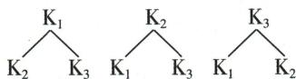

> [!success]- 必刷题
>
> > [!success] **【答案】** D
>
> > [!note]- **【解析】**
> > 画树状图如下：
> >
> > 
> >
> > 共有6种等可能的结果,能让两盏灯泡 $L_{1}, L_{2}$ 同时发光的有两种:闭合 $K_{2}, K_{3}$ ,闭合 $K_{3}, K_{2}$ , 则 P(能让两盏灯泡 $L_{1}, L_{2}$ 同时发光) = $\frac{2}{6}$ = $\frac{1}{3}$ .
> >
> > 故选 **D**.
