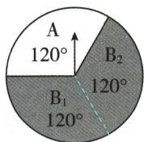
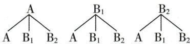

> [!success]- 必刷题
>
> > [!success] **【答案】** D
>
> > [!note]- **【解析】**
> > 白色区域用 A 表示, 黑色区域分成两个圆心角均为 $120^{\circ}$ 的扇形, 分别用 $B_{1}$ 和 $B_{2}$ 表示, 如图.
> >
> > 
> >
> > 画树状图如下：
> >
> > 
> >
> > 一共有9种等可能的结果,其中指针一次落在白色区域,一次落在黑色区域的结果有4种,∴指针一次落在白色区域,一次落在黑色区域的概率是 $\frac{4}{9}$ ,故选D.
> >
> > 初中必刷题 数学九年级上册 RJ
