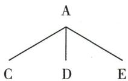
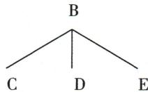

> [!success]- 必刷题
>
> > [!success] **【答案】** C
>
> > [!note]- **【解析】**
> > 根据题意,画出树状图如下:
> >
> > 入口
> >
> > 
> >
> > 
> >
> > 由树状图可知, 小红随机选择一个入口进入, 一个出口离开, 共有 6 种等可能的结果, 其中从 A 口进入, 从 D 口离开的有 1 种, $\therefore P(\text{小红从 A 口进入}, \text{从 D 口离开}) = \frac{1}{6}$ .
> >
> > 故选 **C**.
