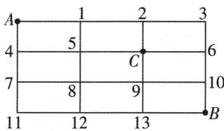
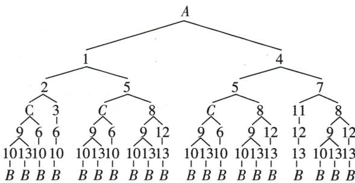

> [!success]- 必刷题
>
> > [!success] **【答案】** D
>
> > [!note]- **【解析】**
> > 如图.
> >
> > 
> >
> > 画树状图如下：
> >
> > 
> >
> > ## 刷有所得
> >
> > 由树状图知, 共有 20 种等可能的结果, 其中经过点 C 的结果有 9 种, 所以经过点 C 的概率为 $\frac{9}{20}$ ,
> >
> > 故选 **D**.
