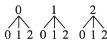

> [!success]- 必刷题
>
> > [!success] **【答案】** $\frac{1}{3}$
>
> > [!note]- **【解析】**
> > 画树状图如下：
> >
> > 画树状图法可以不重复不遗漏地列出所有可能的结果,适合两步或两步以上完成的事件.用到的知识点为概率= $\frac{所求情况数}{总情况数}$ .
> >
> > 
> >
> > 共有9种等可能的结果,点 $(a,b)$ 在函数 $y=(x-1)^{2}$ 的图象上的结果有3种,∴点 $(a,b)$ 在函数 $y=(x-1)^{2}$ 的图象上的概率为 $\frac{3}{9}=\frac{1}{3}$ ,故答案为 $\frac{1}{3}$ .
