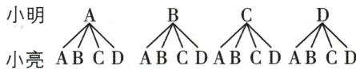

> [!success]- 必刷题
>
> > [!success] **【答案】** $\frac{1}{4}$
>
> > [!note]- **【解析】**
> > 画树状图如下：
> >
> > 
> >
> > 共有 16 种等可能的结果, 其中两人所选的板块课程恰好相同的有 4 种结果, 所以两人所选的板块课程恰好相同的概率为 $\frac{4}{16} = \frac{1}{4}$ , 故答案为 $\frac{1}{4}$ .
> >
> > ## 关键点拨
> >
> > (2) 判断游戏的公平性就要分别计算甲、乙获胜的概率, 概率相等就公平, 否则就不公平.
