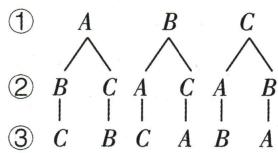

> [!success]- 必刷题
>
> > [!success] **【答案】** 详见解析
>
> > [!note]- **【解析】**
> > 【解】(1)∵ $A=4x^{2}+5x+6$ , $B=-3x^{2}-x-2$ , $C=x^{2}+4x$ , ∴ $P=A-B+C=(4x^{2}+5x+6)-(-3x^{2}-x-2)+(x^{2}+4x)=4x^{2}+5x+6+3x^{2}+x+2+x^{2}+4x=8x^{2}+10x+8$ . 当 x=2 时, $P=8\times2^{2}+10\times2+8=32+20+8=60$ .
> >
> > (2)由(1)得 $A - B + C = 8x^{2} + 10x + 8$ ，结果不为常数，则 $C - B + A = 8x^{2} + 10x + 8$ ，结果不为常数； $\because B - A + C = (-3x^{2} - x - 2) - (4x^{2} + 5x + 6) + (x^{2} + 4x) = -3x^{2} - x - 2 - 4x^{2} - 5x - 6 + x^{2} + 4x = -6x^{2} - 2x - 8,\therefore B - A + C$ 的结果不为常数，则 $C - A + B$ 的结果不为常数； $\because A - C + B = (4x^{2} + 5x + 6) - (x^{2} + 4x) + (-3x^{2} - x - 2) = 4x^{2} + 5x + 6 - x^{2} - 4x - 3x^{2} - x - 2 = 4,\therefore A - C + B$ 的结果为常数，则 $B - C + A$ 的结果为常数.
> >
> > 画树状图如下:
> > - **①**：
> > - **②**：
> >
> > 共有 6 种等可能的结果, 其中能使运算结果为常数的有 2 种,
> >
> > ∴ 能使运算结果为常数的概率为 $\frac{2}{6} = \frac{1}{3}$ .
