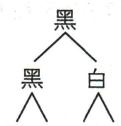
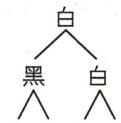

> [!success]- 必刷题
>
> > [!success] **【答案】** B
>
> > [!note]- **【解析】**
> > 画树状图如下：
> >
> > 第1个小正方形
> > 第2个小正方形
> > 第3个小正方形
> >
> > 
> >
> > 
> >
> > 由树状图知,共有8种等可能的结果,其中恰好是两个黑色小正方形和一个白色小正方形的结果有3种,所以恰好是两个黑色小正方形和一个白色小正方形的概率为 $\frac{3}{8}$ ,
> >
> > 故选 **B**.
