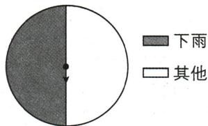

> [!success]- 必刷题
>
> > [!success] **【答案】** A
>
> > [!note]- **【解析】**
> > 【解】(1)如图所示.
> >
> > 
> >
> > (2)画树状图如下:
> >
> > A地 下雨 其他 其他 其他 其他
> > B地下雨其他下雨其他下雨其他下雨其他下雨其他
> > 共有10种等可能的结果,其中某天A地、B地都下雨的结果有1种,∴某天A地、B地都下雨的概率为 $\frac{1}{10}$ .
