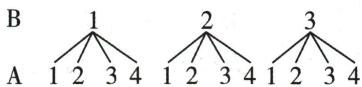
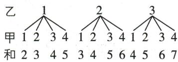

> [!success]- 必刷题
>
> > [!success] **【答案】** $\frac{1}{4}$
>
> > [!note]- **【解析】**
> > 【解】(1)画树状图如下：
> >
> > 
> >
> > 共有 12 种等可能的结果, 其中两个数字相同的结果有 3 种, ∴ 两个小球上数字相同的概率是 $\frac{3}{12} = \frac{1}{4}$ , 故答案为 $\frac{1}{4}$ .
> >
> > (2)画树状图如下:
> >
> > 
> >
> > 由树状图知,共有12种等可能的结果,其中两人摸到小球的数字之和为奇数的有6种,两人摸到小球的数字之和为偶数的也有6种, $\therefore P(\text{甲获胜})=P(\text{乙获胜})=\frac{1}{2},\therefore$ 此游戏对双方是公平的.
