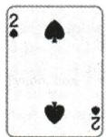
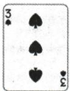
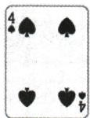
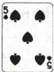

<!-- question-source:start -->
1[中]如图,桌面上放置四张扑克牌(背面完全一样),将数字一面向下扣在桌面上.小明和小李做如下游戏:小明和小李依次随机从中抽出一张,将得到的数字相加,若和为偶数,则小明获胜;若和为奇数,则小李获胜.小明获胜的概率是()

A. $\frac{1}{2}$ B. $\frac{1}{3}$ C. $\frac{1}{4}$ D. $\frac{1}{6}$
<!-- question-source:end -->

![[Q00107060A1]]
