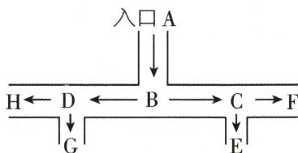

<!-- question-source:start -->
5[2024 北京海淀区期末, 中]遥控电动跑车竞速是青少年喜欢的活动. 如图是某赛道的部分通行路线示意图, 某赛车从入口 A 驶入, 行至每个岔路口选择前方两条线路的可能性相同, 则该赛车从 F 口驶出的概率是 ( )

A. $\frac{1}{3}$ B. $\frac{1}{4}$ C. $\frac{1}{5}$ D. $\frac{1}{6}$
<!-- question-source:end -->

![[Q00107064A1]]
